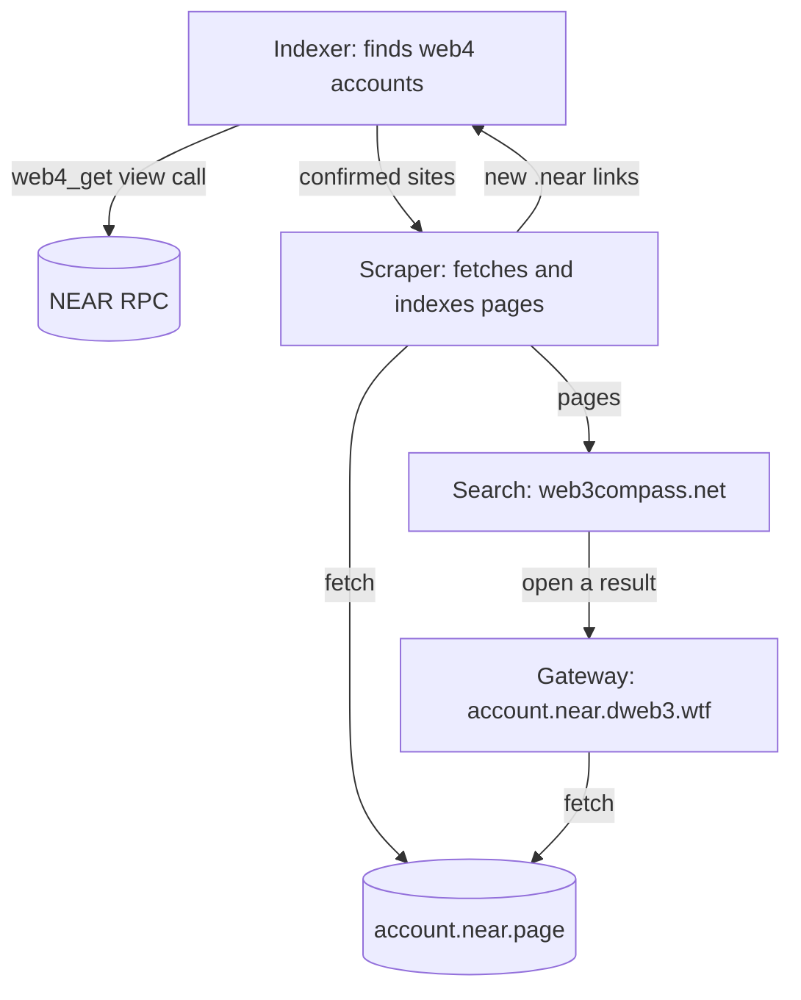

# Web3 Compass × NEAR web4

**Search and open NEAR web4 sites from any browser.**

[Search NEAR sites](https://www.web3compass.net/search?term=web4&ns=NEAR) ·
[Example site](https://awesomeweb4.near.dweb3.wtf/) ·
[Web3 Compass](https://www.web3compass.net)

[Web4](https://github.com/vgrichina/web4) lets a NEAR account serve a whole
website from its smart contract. These sites are fully on-chain, but nothing
lists them, so they are hard to find. Most search engines never see them.

[Web3 Compass](https://www.web3compass.net) is a search engine for decentralized
websites. This repository is its NEAR support. It finds `.near` accounts that
serve a web4 site, indexes their pages so they can be searched alongside ENS,
Unstoppable, TON and Solana sites, and serves each one at
`https://<account>.near.dweb3.wtf`.

## Try it

- Search only NEAR sites:
  [web3compass.net/search?term=web4&ns=NEAR](https://www.web3compass.net/search?term=web4&ns=NEAR),
  or choose **NEAR** in the search bar
- Open a web4 site through the gateway:
  [awesomeweb4.near.dweb3.wtf](https://awesomeweb4.near.dweb3.wtf/) ·
  [web4.near.dweb3.wtf](https://web4.near.dweb3.wtf/) ·
  [devhub.near.dweb3.wtf](https://devhub.near.dweb3.wtf/)
- Old path-style links also work: `dweb3.wtf/awesomeweb4.near` redirects to
  the site

## How it works

1. **Find.** No registry of web4 sites exists, so the indexer starts from a
   list of known sites and keeps a queue of `.near` names. For each name, it
   calls the account's `web4_get` view method. If the method exists, the
   account is a web4 site. By default, each name is checked again every 7 days.
2. **Index.** The scraper fetches `https://<account>.near.page/` and keeps a
   fingerprint of it (ETag, Last-Modified or a SHA-256 of the page), so a
   site is only indexed again when its content changes.
3. **Discover.** Links to other `<account>.near.page` sites become new
   candidates. Each one is confirmed on-chain before it is fetched.
4. **Search.** A `ns=NEAR` filter limits results to `.near` sites. Each result
   links to the gateway.
5. **Serve.** The gateway serves the site under its own domain, fetching each
   page from `near.page` over HTTPS.

## Security

The code reads untrusted data (the chain and other people's web pages), so none
of that data is allowed to steer it.

- **Read-only on chain.** It makes view calls only: no keys, no wallet, no
  transactions.
- **One strict name check.** Only top-level accounts made of lowercase letters,
  digits and hyphens (`^[\da-z]+(-[\da-z]+)*\.near$`) can become a hostname,
  and the indexer, scraper and gateway each apply the check.
- **Locked-down fetches.** The host is always `<account>.near.page`. Redirects
  are followed only to that same host, at most 3 times. There is no proxy, and
  every fetch has a timeout and a size limit.
- **Links are only hints.** A name found on a page is confirmed on-chain before
  anything is fetched. By default, at most 50 names are taken from a page, and
  discovery pauses while 2,000 names are unconfirmed.
- **Wallets stay on near.page.** Web4 sign-in and transaction paths, and any
  request other than GET or HEAD, are redirected to `near.page`, so wallet
  cookies are never set on the gateway's domain. When the gateway fetches a
  page, the visitor's IP, Referer and User-Agent are not passed on.
- **Errors never give wrong answers.** A network error leaves a name to be
  checked again later instead of marking it "not a site". Failing sites are
  retried at most 5 times.

## Repository layout

| Folder      | Contents                                                                    |
| ----------- | --------------------------------------------------------------------------- |
| `indexer/`  | NEAR RPC client, web4 check, refresh job, database migration                 |
| `scraper/`  | guarded fetch, link discovery, change detection, page indexing               |
| `gateway/`  | routing for `<account>.near.dweb3.wtf`                                       |
| `search/`   | the NEAR filter and result links                                            |
| `frontend/` | NEAR in the web3compass.net interface                                       |

This is the NEAR part of a larger product, not a standalone build. Files that
are only about NEAR are included whole. From files that also do other things,
only the NEAR code is included, in files named `*.near.ts` (and
`Caddyfile.near`).

## Configuration

Every NEAR setting is optional and listed with its default in
[`.env.example`](.env.example). None of them are secret.

## License

[MIT](LICENSE)
