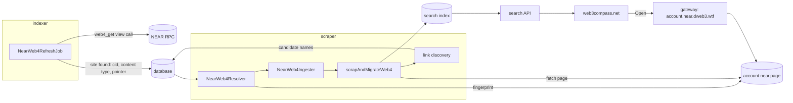

# Web3 Compass × NEAR web4

[Web3 Compass](https://www.web3compass.net) is a search engine for decentralized
websites: sites published under blockchain names (ENS, Unstoppable, TON, SNS and
others) and hosted on IPFS, Swarm or TON. This repository holds the code that
adds **NEAR**: it finds `.near` accounts that serve a
[web4](https://github.com/vgrichina/web4) site, indexes their pages so they show
up in search, and serves each one at `https://<account>.near.dweb3.wtf`.

## See it live

- **Search filtered to NEAR:**
  [web3compass.net/search?term=web4&ns=NEAR](https://www.web3compass.net/search?term=web4&ns=NEAR)
  (the **NEAR** button in the search bar's scope row sets this filter)
- **A web4 site through our gateway:**
  [awesomeweb4.near.dweb3.wtf](https://awesomeweb4.near.dweb3.wtf/), and also
  [web4.near.dweb3.wtf](https://web4.near.dweb3.wtf/) and
  [devhub.near.dweb3.wtf](https://devhub.near.dweb3.wtf/)

## What is in this repository

This repository collects the NEAR code from each part of Web3 Compass, grouped
by the part it belongs to. It is a showcase of the NEAR work, not a standalone
build.

| Folder      | Part              | Contents                                                                                                           |
| ----------- | ----------------- | ------------------------------------------------------------------------------------------------------------------ |
| `indexer/`  | indexer           | NEAR module (JSON-RPC client, web4 check), the refresh job that finds and re-checks sites, the database migration  |
| `scraper/`  | scraper           | the guarded web4 fetch, link discovery, the pointer resolver and ingester, and the web4 scrape method               |
| `gateway/`  | dweb3.wtf gateway | the `.near` routing that serves sites at `<account>.near.dweb3.wtf`                                                |
| `search/`   | search API        | the `ns=NEAR` filter and how result links are built for `.near` sites; the same filters in the public developer API |
| `frontend/` | web3compass.net   | the NEAR naming-system entries and styles                                                                           |

Files that exist only for NEAR are copied whole and unchanged. For files that
are only partly about NEAR, the repository holds only the NEAR methods, in files
named `*.near.ts` (and `Caddyfile.near`). Each of those starts with a short
header marking it as an excerpt; everything else in that file was left out.

## How the parts fit together

1. **Finding sites (indexer).** NEAR has no registry of web4 sites, so the
   refresh job starts from a list of 23 known sites (from the web4 README and
   the awesomeweb4 catalog) and keeps a queue of `.near` names in the database.
   Every minute it takes the names that were never checked or were checked more
   than 7 days ago and calls the account's `web4_get` view method over NEAR
   JSON-RPC. If the method exists, the account is a web4 site: its row is marked
   with content type `near-web4` and given a content pointer for the scraper. If
   the account or the method does not exist, the row is marked as no site.
   `indexer/jobs/near-web4-refresh.job.ts`, `indexer/near/`.
2. **Fetching and indexing (scraper).** For each pointer, the resolver fetches
   `https://<account>.near.page/` and records a fingerprint (ETag, else
   Last-Modified, else a SHA-256 of the body), so a site is scraped again only
   when its content actually changed. The ingester then fetches the page, parses
   it and writes it to the search index. `scraper/`.
3. **Discovering more sites (scraper → indexer).** After a page is indexed, the
   `<account>.near.page` links on it are stored as candidate names. They go back
   into step 1's queue and are only treated as sites once the chain confirms
   them. `scraper/near-web4-discovery.ts`.
4. **Search.** `ns=NEAR` limits results to `.near` names. A web4 site has no
   content hash, so its result links to our gateway rather than to an IPFS
   gateway. `search/`.
5. **Serving (gateway).** `<account>.near.dweb3.wtf` looks up the name, sees
   it is a web4 site, and fetches the page from `<account>.near.page` over
   HTTPS to serve it under our domain. `gateway/`.

## Security design

The NEAR code reads public data from untrusted places (the chain, other
people's web pages), so it is built so that none of that data can steer it.

- **Read-only on chain.** Only view calls: no keys, no wallet, no transactions.
  The optional RPC API key is read from the environment and never stored in
  the code.
- **One strict account check, applied everywhere a name becomes a hostname.**
  Only top-level accounts made of lowercase letters, digits and single hyphens,
  at most 64 characters (`^[\da-z]+(-[\da-z]+)*\.near$`). The indexer, the
  scraper and the gateway each check it again before building a URL, so a bad
  value in the database still cannot make a service connect to another host.
- **A locked-down fetch** (`scraper/near-web4-fetch.ts`, the only place a web4
  URL is built or fetched). The host is always `<account>.near.page`, built from
  the checked name; redirects are followed by hand, at most 3, and only to the
  same HTTPS host — anything else is returned as-is, never followed; no proxy;
  a timeout and a response-size cap.
- **Links on pages are only hints.** A name found on a page is stored as a
  candidate and checked on-chain before anything is fetched, and the fetch then
  goes to the fixed `near.page` host, never to the link that mentioned it. At
  most 50 names are taken from one page, and discovery pauses while 2,000 names
  are unconfirmed, so a page cannot flood the queue with made-up names.
- **Wallet flows stay on near.page.** The gateway only proxies plain page loads.
  Anything that is not GET/HEAD, and everything under `/web4/` (web4's wallet
  sign-in and transaction paths, which keep keys in cookies), is redirected to
  `near.page`, so those cookies are never set on our domain. Requests to
  `near.page` go out without the visitor's IP, Referer or User-Agent. If
  `near.page` ever starts blocking our server, `WEB4_GATEWAY_MODE=redirect`
  sends every request there instead.
- **Failures don't produce wrong answers.** A network or RPC error leaves the
  row for the next run instead of marking it "no site"; a site that is down is
  rechecked within an hour; failing fetches stop after 5 attempts.
- **Safe database changes.** The migration adds the `near` value with
  `ALTER TYPE … ADD VALUE`, which does not rewrite the main table, and every
  insert uses `ON CONFLICT DO NOTHING`, so existing rows are never overwritten.

## Configuration

[`.env.example`](.env.example) lists every NEAR setting with its default. None
are secret, and NEAR indexing and link discovery are off unless enabled.

## License

[MIT](LICENSE)
